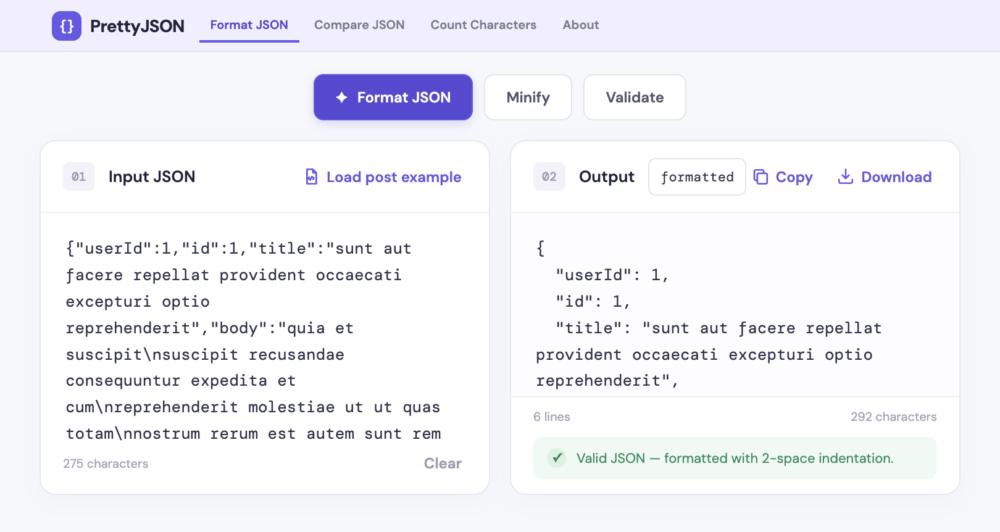
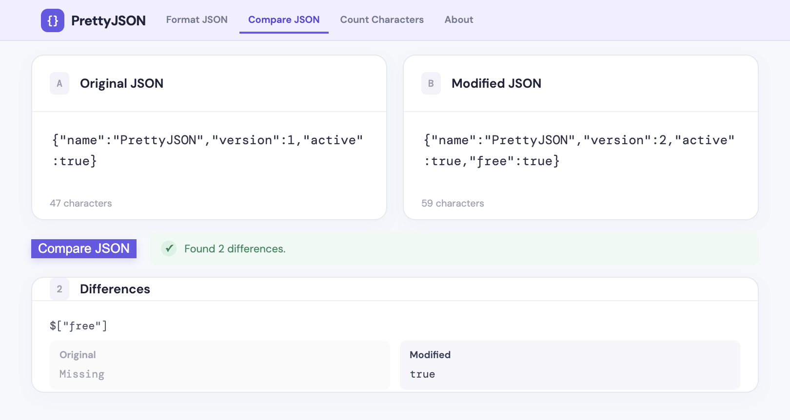
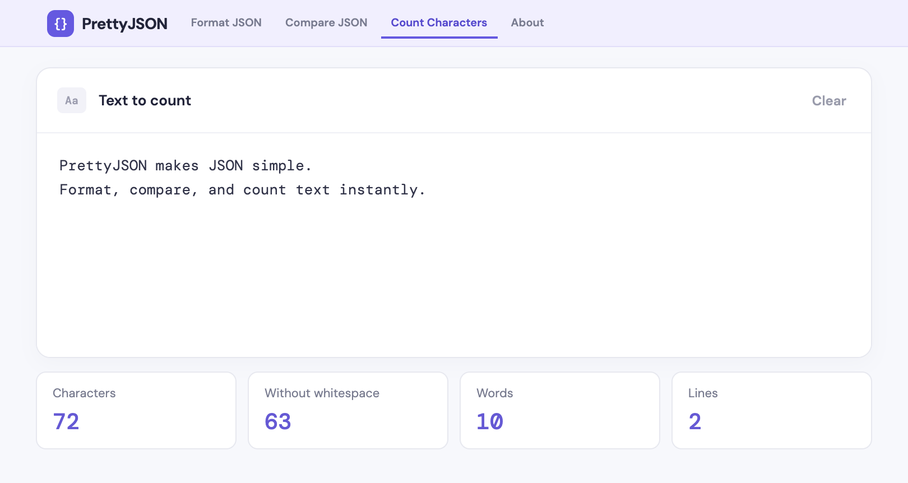

# PrettyJSON

A responsive set of browser-based tools to format, minify, validate, and compare JSON, plus count characters. Copy or download formatted JSON. Your data is processed locally and is not sent to a server.

## Screenshots

| Format and validate JSON | Compare JSON |
| --- | --- |
|  |  |

### Count characters



## What to install

1. Install **Node.js LTS** from [nodejs.org](https://nodejs.org/). npm is included with Node.js.
2. Unzip this folder and open a terminal in `prettyjson-react`.
3. Run:

   ```bash
   npm install
   npm run dev
   ```

4. Open the local address printed by Vite (usually `http://localhost:5173`). Press `Ctrl+C` in the terminal to stop the development server.

## Production build

Run `npm run build`. The website files will be generated in the `dist` folder. To preview that build locally, run `npm run preview`.

## Deploy to GitHub Pages

This project is published at <https://sanjaykpatel09.github.io/> from the `sanjaykpatel09.github.io` repository.

1. Push this project to the `main` branch of the `sanjaykpatel09.github.io` repository.
2. In the repository, open **Settings → Pages** and set the build and deployment source to **GitHub Actions**.
3. Each push to `main` will build and deploy the site. The published URL will appear in the workflow run and in **Settings → Pages**.

The GitHub Actions workflow automatically uses the root path for this `*.github.io` repository.

## Deploy to Netlify

This project is also published at <https://prettyjson2.netlify.app/>. Netlify is connected to the same GitHub repository and automatically deploys changes pushed to `main`.

SEO metadata, social sharing tags, and structured data are maintained in `index.html`. The public crawl rules and sitemap are in `public/robots.txt` and `public/sitemap.xml`; update their canonical URL if the primary site address changes.

## Customize

- Change the page behavior in `src/App.jsx`.
- Change colors and layout in `src/styles.css`.
- Update the browser title and description in `index.html`.

This is a front-end starter only. It does not include hosting, a domain, ads, analytics, payment processing, or a backend. Before publishing, replace the placeholder product branding and add your own privacy, contact, and policy pages. The Google Fonts import is optional; system fonts will be used if the font service is unavailable.
